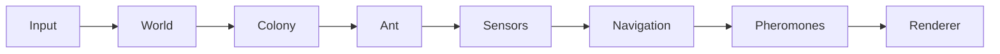
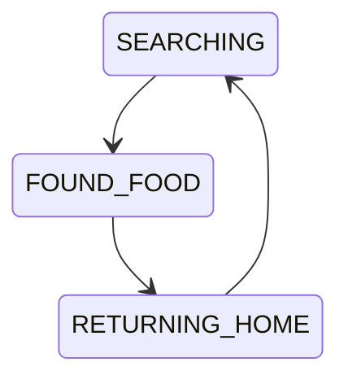

# 🐜 Swarm Intelligence Lab


Interactive visualization of emergent collective intelligence inspired by real ant colonies.

This project explores how simple agents can collectively solve routing and optimization problems without centralized control.

## Motivation

An individual ant:

- has no global map
- cannot compute shortest paths
- possesses only local information
- follows simple behavioural rules

Yet colonies can:

- discover resources
- optimize routes
- adapt to environmental changes
- recover from disruptions

This project visualizes how those global behaviours emerge.

## Features
- Colony simulation
- Autonomous agents
- Pheromone trails
- Route discovery
- Traffic density maps
- Obstacle placement
- Multiple food sources
- Heatmap visualization

## Architecture


## Agent State Machine


## Pheromone Model
P(t+1)=P(t)*(1-rho)

Example:

```text
P_current       = 100
evaporationRate = 0.005

P_next = 99.5
```

This mechanism allows obsolete routes to fade and helps the colony adapt to environmental changes.

## Route Selection

Each ant samples three directions:

```text
      Forward

Left          Right

       Ant
```

Candidate directions are weighted using local pheromone concentrations.

```text
               pheromone(i)^alpha
P(direction) = -------------------
               Σ pheromone(j)^alpha
```

Where:

- `pheromone(i)` - local trail strength
- `alpha` - pheromone importance coefficient

---

## References

### Marco Dorigo
Optimization, Learning and Natural Algorithms (1992)

### Swarm Intelligence
James Kennedy, Russell Eberhart (2001)

### Stigmergy
Pierre‑Paul Grassé (1959)

### AntNet
Gianni Di Caro, Marco Dorigo

## Running
```bash
git clone https://github.com/e1ephntbrd/swarm-intelligence-lab.git
cd swarm-intelligence-lab
make up
```

## 📜 License

Distributed under the **MIT License**. See `LICENSE` for more information.
