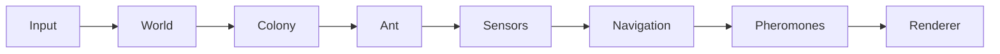
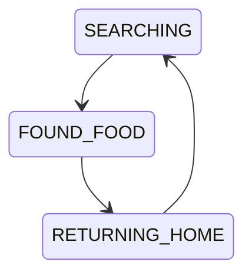

# 🐜 Swarm Intelligence Lab


Interactive visualization of emergent collective intelligence inspired by real ant colonies.

## Motivation
How do simple agents create complex logistics networks without centralized control? This project explores swarm intelligence, pheromone routing and emergent behaviour.

## Features
- Colony simulation
- Autonomous agents
- Pheromone trails
- Route discovery
- Traffic density maps
- Obstacle placement
- Multiple food sources
- Heatmap visualization

## Architecture


## Agent State Machine


## Pheromone Model
P(t+1)=P(t)*(1-rho)

## Running
```bash
git clone https://github.com/e1ephntbrd/swarm-intelligence-lab.git
cd swarm-intelligence-lab
make up
```

## Completed
- Foundation
- World Engine
- Ant Agent
- Colony Simulation
- Pheromones
- Route Selection

## Planned
- Multi colony competition
- Weather system
- GPU acceleration
- Predators

## What I Learned
- Agent based modeling
- Swarm intelligence
- Emergent systems
- Canvas rendering
- Simulation architecture
